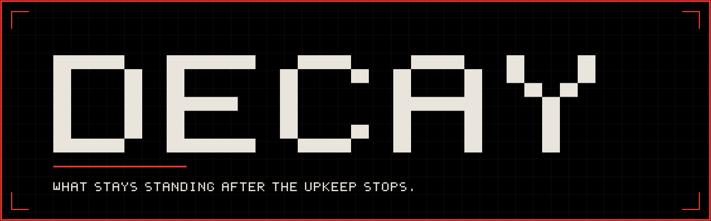
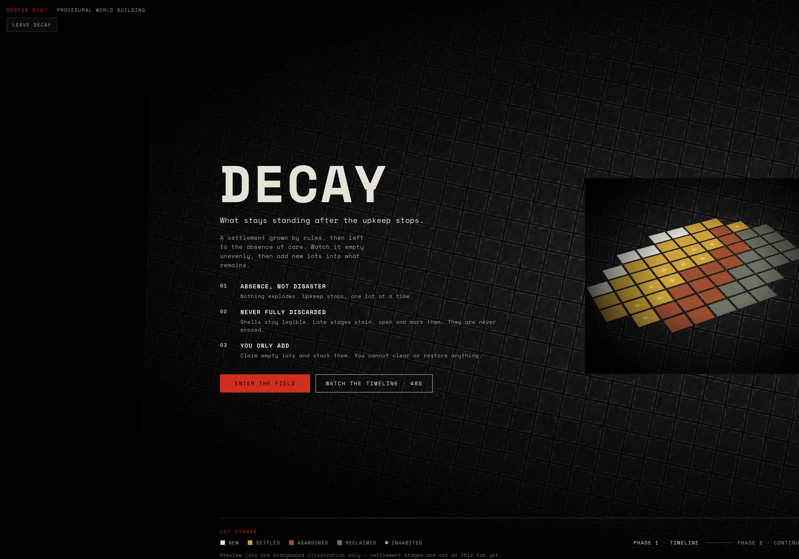
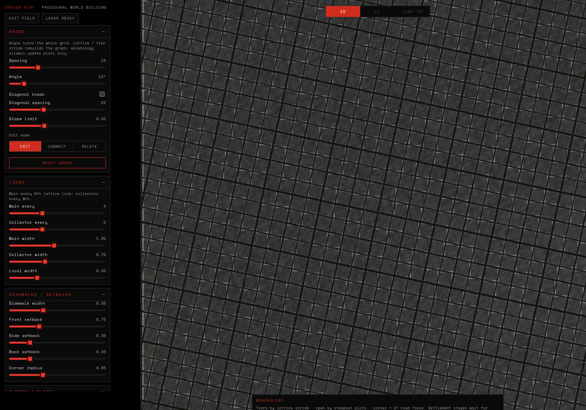
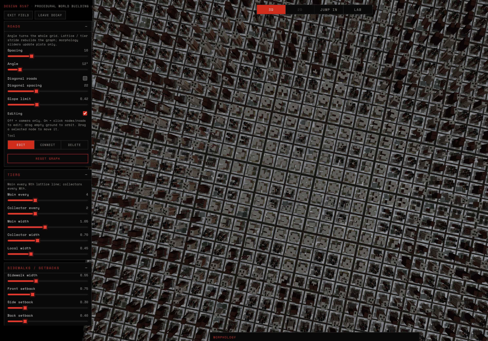
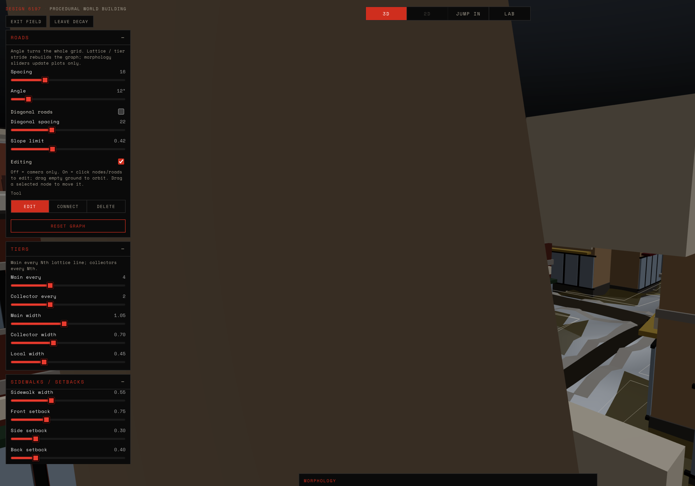
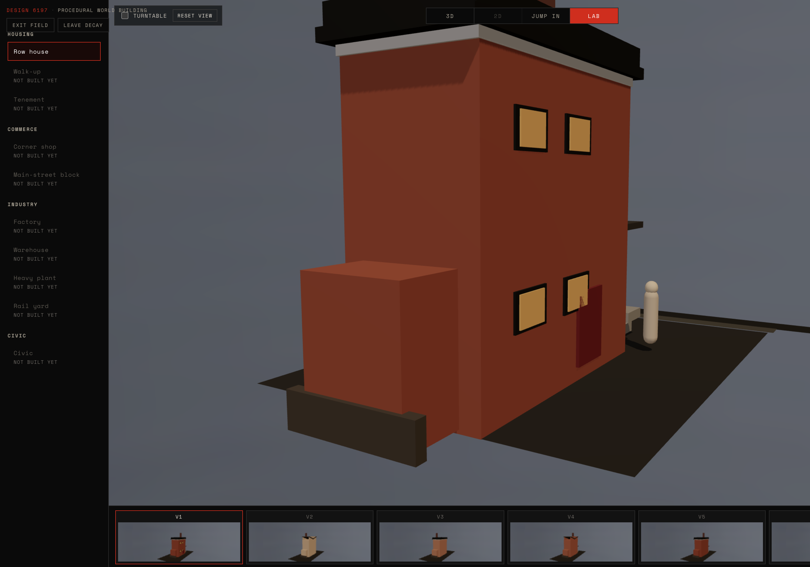

<div align="center">



<br />

<a href="https://threejs.org/"></a>
<a href="https://react.dev/"></a>
<a href="https://www.typescriptlang.org/"></a>


<p><strong>Design 6197 · Procedural World Building · Sarah Rupani · Cornell Fall 2026</strong></p>


<p>
DECAY is a procedural city built in Three.js and React. It grows a working industrial town from rules, then lets that town empty out unevenly after deindustrialization. You watch it happen, then add new lots into what remains.
</p>

</div>

> [!CAUTION]
> Nothing explodes. Nothing is erased.

<div align="center">

[The brief](Planning/DECAY.md) ·
[Decay method](Tutorials/decay_texture_vs_geometry.md) ·
[Run it](#run-it) ·
[Class progress](#progress-by-class)

</div>

<div align="center">

</div>

| Number | Rule | What it means |
| :----: | :--- | :--- |
| **01** | Absence, not disaster | Upkeep stops, one lot at a time. Nothing explodes. |
| **02** | Never fully discarded | Shells stay legible. Late stages stain, open and mark them. They are never erased. |
| **03** | You only add | Claim empty lots and stack them. You cannot clear or restore anything. |

<div align="center">

### Screenshots

| Entry | City from above |
| :---: | :---: |
|  |  |
| Entry screen | Morphology · top-down |

| Street | Street close-up |
| :---: | :---: |
|  |  |
| Street level | Street close-up |

| Lab |
| :---: |
|  |
| Building Lab |

<!-- Placeholders — drop real PNGs into assets/screenshots/ to fill these rows. -->

| Timeline 0s | Timeline 24s | Timeline 48s |
| :---: | :---: | :---: |
|  |  |  |
| 0s · fill later | 24s · fill later | 48s · fill later |

| Texture vs geometry |
| :---: |
|  |
| Before / after · fill later |

</div>

<div align="center">

</div>

| Layer | Works today |
| :--- | :--- |
| **World** | 520² noise terrain; editable road graph (main / collector / local); blocks + plots from closed loops |
| **Land use** | Seven uses, rule + quota assignment (no randomness) |
| **Buildings** | Housing row + walk-up parts; industry + commerce parts; tenement + civic as boxes |
| **Lab** | Architecture + Materiality pages; Apply is **row only** (in progress for other types) |
| **Jump In** | First-person walk on roads / plots |
| **Debug** | FPS, forms, camera, timeline counts, hover plot |
| **Process log** | Stage flips, rebuilds, Lab apply, Jump In |

| Land use | Target | Rule |
| :--- | :---: | :--- |
| Park | ~open share | Open plots |
| Farm | 7% | Flat outer rim |
| Industry | 12% | Flat + main, outside core |
| Commerce | 10% | Main + junction + core |
| Yard | 1.5% | Main-spine corridor |
| Civic | 2.5% | Near collectors, spaced |
| Housing | remainder | Everything else |

<div align="center">

</div>

| | Texture | Geometry |
| :--- | :--- | :--- |
| **What** | Grime, rain streaks, rust, chalk, salt, moss on the same mesh | Missing panel / broken panes / gutter in shader; debris + tarp meshes |
| **How** | Wear shader mixes color by stage + layer strengths | Late layers (`startWear ≥ 2`), local + capped |
| **Moves vertices?** | No | No for shader voids; yes for debris/tarp instances |
| **Starts** | Settled → abandoned → reclaimed bands | Abandoned / reclaimed (late) |

**Stages** (Phase 1 · 48s timeline — **wired**): new → settled → abandoned → reclaimed. Onset staggers by rim / slope / size.

**Wear 0–3** (**wired** on box shells + Lab): scrub / distance / stage index drive `aWear`. Parts-kit houses in Normal view stay Before colors — **not yet** on the timeline wear path.

**Palette:** Era 0 = Before, 1 = After (`HOUSE_BEFORE` → `HOUSE_AFTER`). City boxes use era tones; Lab remaps vertex colors. Timeline does **not** scrub era by itself.

<div align="center">

</div>

| Done | In progress | Planned |
| :--- | :--- | :--- |
| Terrain, roads, plots | Lab types beyond row | 2D field map |
| 7 land uses + views | Tenement / civic parts kits | Story stacking on claims |
| Housing / industry / commerce forms | Wear on parts-kit in Normal | Full Phase 2 dock |
| 48s timeline + stages | Claim = one empty lot only | |
| Box wear + Lab Materiality | | |
| Jump In, Debug, Process log | | |

<a id="run-it"></a>
<div align="center">

</div>

**Node.js 24+** (see `react-app/.nvmrc`) · **npm**

```bash
git clone https://github.com/srupani0810/Procedural_World_Building_Fall_-26.git
cd Procedural_World_Building_Fall_-26/react-app
npm install
npm run dev      # http://localhost:5173
npm run build    # → react-app/dist
npm run preview  # preview production build
```

Open the Vite URL, then choose the **DECAY** tab.

### Controls

| Mode | Input |
| :--- | :--- |
| **Orbit (3D)** | Drag orbit · scroll zoom · pan (OrbitControls; off in Jump In) |
| **Road editing** | **Editing** on: click nodes/roads; drag empty ground to orbit; drag selected node to move. Tools: Edit · Connect · Delete |
| **Jump In** | Arrows/WASD walk+turn · Q/E strafe · Shift run · drag look · Esc exit |
| **Debug** | `` ` `` (backtick) toggles Debug (persisted; off = no debug cost) |
| **Top bar** | **3D** · **2D** (not built yet) · **Jump In** · **Lab** (Architecture / Materiality) |

---

<div align="center">

</div>

# Procedural World Building — Fall ’26

## Contents

- [Progress by class](#progress-by-class) · [Requirements](#requirements) · [Getting started](#getting-started) · [Project structure](#project-structure) · [Built with](#built-with) · [Author](#author)

## Progress by class

<details id="class-01--intro">
<summary><strong>Class 01 — Intro</strong> · <a href="https://www.figma.com/deck/POK6565upmCTz79sU6Q2ns/PWB---Class-01">Deck</a></summary>

**Class topics:** Course intro & PCG framing; Microscope-style worldbuilding; tools / version control (**Git + GitHub**).

**App progress:** Repo setup, `.gitignore`, first commits; planning / prompt log started.

<!--  -->

</details>

<details id="class-02--web-tools-react--threejs">
<summary><strong>Class 02 — Web tools: React + Three.js</strong> · <a href="https://www.figma.com/deck/PFjBPB5uuqJIZd3em9Kk7P">Deck</a></summary>

**Class topics:** Traditional web stack (HTML / CSS / JS); tools — **React + Three.js** app shell.

**App progress:** React canvas with orbit camera; center object; live sliders; style-guide UI pass.

<!--  -->

</details>

<details id="class-03--noise-field--simulations">
<summary><strong>Class 03 — Noise Field + Simulations</strong> · <a href="https://www.figma.com/deck/Hc8vcT9xVjjd1p3sT5xKgQ/PWB---Class-03">Deck</a></summary>

**Class topics / Assignment 1:** 3D grid in the viewport; 2D view of a noise equation; apply noise to the 3D grid; slider controls for noise + grid resolution; shaping ops via dropdown (+ own sliders). Extensions: layered noise, noise-type menu, blending.

**App progress:** 3D / 2D tabs; heightfield; hydraulic erosion sim on the 2D map; blue→red height coloring on the solid 3D mesh; grayscale heightmap preview.

<!--  -->


</details>

<details id="class-04--voxels">
<summary><strong>Class 04 — Voxels</strong> · <a href="https://www.figma.com/deck/nGInnCOpuzyqmq9z8mFUod/PWB---Class-04">Deck</a></summary>

**Class topics:** Geographic data, voxels, and terraforming.

**App progress:** Voxels tab from the shared 3D field; grid → Marching Cubes / Interactive drop down; UI graphic changes; tooltips; gradient mapping.

<!--  -->


</details>

<details id="class-05--shaders">
<summary><strong>Class 05 — Shaders</strong> · <a href="https://www.figma.com/deck/XP1cVSq9wjUzFZuUn0ury1/PWB---Class-05">Deck</a></summary>

**Class topics / Assignment 2:** Shader studies; show what shaders can do for simulations; choose strategies and why; dedicated in-app section to swap shader approaches.

**App progress:** Shader Studies; GLSL; technical implementation.

<!--  -->

</details>

<details>
<summary>How to add a class’s screenshots</summary>

1. Save a PNG/JPG into the matching folder, e.g. `docs/progress/class-03/erosion.png`.
2. Under that class in this README, turn on the image line (delete `<!--` and `-->`), or add another:

   ```markdown
   
   ```

3. Commit the image(s) and the README, then push — they appear on the GitHub repo page.
4. For the next class deck: add `docs/progress/class-06/`, a TOC link, and a matching class section (with the Figma deck URL).

</details>

## Requirements

- **Node.js 24+** (see `react-app/.nvmrc`) · **npm** · on macOS with nvm: `cd react-app && nvm use`

## Getting started

Same clone URL and npm scripts as **[Run it](#run-it)** above.

## Project structure

`README.md` · `Planning/` · `Tutorials/` · `docs/progress/` · `Analysis/` · `react-app/` (Vite + React + Three.js). Notes: [Tutorials](./Tutorials/) · [Planning](./Planning/) · [src](./react-app/src/)

## Built with

[React](https://react.dev/) + [TypeScript](https://www.typescriptlang.org/) · [Three.js](https://threejs.org/) via [React Three Fiber](https://r3f.docs.pmnd.rs/) + [drei](https://github.com/pmndrs/drei)

## Author

**Sarah Rupani** — course project for **DESIGN 6197 — Procedural World Building**, Cornell University, Fall 2026.

---

<div align="center">

</div>

- **Chaim Gingold**, *Building SimCity: How to Put the World in a Machine* (MIT Press, 2024) — method reference for layered fields and the city as a set of grids (not a visual costume).
- **Own references (to fill):** photos · readings · other projects —

---

<div align="center">

Built by Sarah Rupani for DESIGN 6197 · Cornell Fall 2026. Code written with AI assistance in Cursor.

Libraries: [Three.js](https://threejs.org/) · [React](https://react.dev/) · [React Three Fiber](https://r3f.docs.pmnd.rs/) · [drei](https://github.com/pmndrs/drei)

</div>
